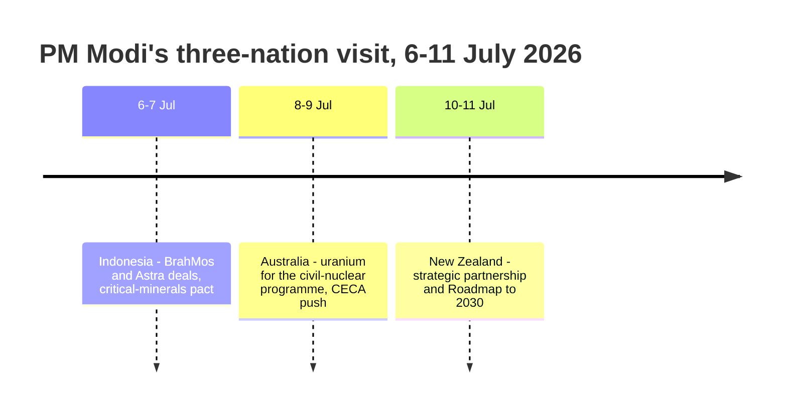

# 2. INTERNATIONAL RELATIONS

[↑ Back to Monthly Index](../CURRENT_AFFAIRS_JULY_2026.md#toc)

July 2026 was one of the most crowded months in recent Indian diplomacy: the 16th India–Japan Annual Summit in New Delhi, a six-day, three-nation visit by the Prime Minister to Indonesia, Australia and New Zealand, a six-country tour by the External Affairs Minister that saw India formally launch its campaign for a **2028–29 non-permanent seat on the UN Security Council**, and a calibrated move towards normalising ties with China through the resumption of border trade. The items below cover these headliners and the shorter developments that filled the month.

---

## 2.1. INDIA–JAPAN 16TH ANNUAL SUMMIT (NEW DELHI, 1–3 JULY 2026)

**Why in News?**
- Prime Minister **Sanae Takaichi of Japan** visited India on **1–3 July 2026** for the **16th India–Japan Annual Summit** in New Delhi — her first visit to India as Prime Minister.
- The summit produced **12 MoUs** and a series of firsts — most notably the **first-ever defence co-development agreement** between the two countries and an **Economic Partnership Framework** aimed at deepening the bilateral relationship.
- PM Modi's personal description of the visiting PM as his **"younger sister"** underscored the strong personal chemistry in the relationship.

**About the Summit and its outcomes**
- The Annual Summit mechanism is the apex of the India–Japan **"Special Strategic and Global Partnership"**, which has steadily expanded from economic collaboration into defence, maritime and technology cooperation.
- **Defence co-development ('UNICORN'):** India and Japan agreed to co-develop a **stealth/low-visibility mast ("UNICORN") for future Indian warships** — a first in their defence-industrial relations, marking Japan's entry into joint weapons development outside the five-eyes orbit.
- **Economic Partnership Framework (EPF):** The two sides resolved to build a comprehensive framework to boost trade, investment and people-to-people ties; fresh **Japanese investment commitments of over US$10 billion** were announced.
- **Technology & AI roadmap:** Blueprints were agreed for cooperation on **generative-AI (large language models), data centres, semiconductors and cybersecurity** — aligning India's Digital India agenda with Japan's tech leadership.
- **Clean energy:** Cooperation on **hydrogen/ammonia co-methanation, biogas and sustainable aviation fuel (SAF)** was stepped up, complementing Japan's energy-transition needs with India's renewables push.

| Pillar | Outcome |
|---|---|
| Defence | First-ever co-development pact; stealth "UNICORN" mast for Indian warships |
| Economy | Economic Partnership Framework; investment commitments > US$10 billion |
| Technology | AI/LLM, data centres, semiconductors, cybersecurity roadmap |
| Energy | Hydrogen/ammonia, biogas, SAF cooperation |
| Transport & infra | Mumbai–Ahmedabad HSR and allied infrastructure cooperation |
| Heritage | 75 years of India–Japan diplomatic ties to be commemorated in 2027 |

**Significance**
- Amidst US–China strategic competition, India and Japan — both members of the **Quad** and partners in the broader Indo-Pacific vision — are consolidating a **counter-dependency, rules-based alliance** in the region.
- The defence co-development agreement signals Japan's transition from a "pacifist" export-averse posture to a global defence-industrial player, and India's preference for tech partners beyond the Russia–China axis.
- For UPSC purposes, remember the sequence: **16th Summit → Delhi (1–3 July 2026) → 'Special Strategic and Global Partnership' → UNICORN defence co-development → Economic Partnership Framework.**

*Source: MEA; PIB; PMO, 1–3 Jul 2026*

---

## 2.2. PM MODI'S THREE-NATION VISIT: INDONESIA, AUSTRALIA AND NEW ZEALAND (6–11 JULY 2026)

**Why in News?**
- The Prime Minister undertook a **six-day, three-nation visit** (6–11 July 2026) covering **Indonesia (6–7 July), Australia (8–9 July) and New Zealand (10–11 July)** — a single itinerary straddling ASEAN, the Quad and the South Pacific.
- The visit yielded landmark outcomes: **BrahMos missile sales to Indonesia**, **uranium-supplies agreement with Australia**, and an upgrade of relations with New Zealand to a **strategic partnership**.

**About the visit, country by country**

| Country | Key outcomes |
|---|---|
| **Indonesia** (6–7 Jul) | Purchase of **BrahMos supersonic cruise missiles** and **Astra air-to-air missiles**; pact on **critical minerals**; India conferred with Indonesia's highest civilian honour; emphasis on maritime security in the Indian and Pacific Oceans |
| **Australia** (8–9 Jul) | **3rd India–Australia Annual Leaders' Summit**; agreement on **uranium exports for Indian civil-nuclear programme** and civilian nuclear cooperation; push to conclude the **India–Australia (CECA)** by 2027; maritime security and **critical minerals** cooperation |
| **New Zealand** (10–11 Jul) | Declaration of an **India–New Zealand strategic partnership** announced in Auckland; **'Roadmap to 2030'** for ties; trade target of about **₹35,000 crore (≈ NZ$7 billion) by 2030**; FTA negotiations to be pursued |

- **Indonesia:** The BrahMos deal makes Indonesia the first Southeast Asian operator of the missile, deepening India's **Act-East** footprint in the Java-Sumatra maritime domain; the critical-minerals pact supports India's electric-vehicle and battery value chains.
- **Australia:** The uranium arrangement operationalises the **2014 India–Australia Civil Nuclear Cooperation Agreement**; the CECA push builds on the ECTA (2022) to cover goods, services and new areas. Australia, India's **Quad** partner, is emerging as a security counterweight in the Indo-Pacific.
- **New Zealand:** The visit was the **first by an Indian PM in about 40 years**; the strategic partnership and Roadmap extend India's Pacific engagement beyond Fiji and the Pacific Islands Forum, and open up dairy, defence and STEM cooperation.

**Significance**
- The trip advanced India's **Indo-Pacific strategy** through three distinct lanes: ASEAN (Indonesia), the Quad (Australia) and the South Pacific (New Zealand).
- It consolidated India's **energy/defence technology exports** (BrahMos) alongside **critical-minerals and civil-nuclear imports** — a two-way strategic trade matrix.
- The New Zealand upgrade signals India's willingness to build diversified Pacific partnerships, particularly as middle powers reassess regional alignments.

*Source: MEA; PIB, 6–11 Jul 2026; NFDC/Indian news agencies, Jul 2026*

---

## 2.3. INDIA–CHINA: BORDER TRADE RESUMES, BUT BORDER TRUST REMAINS BRITTLE

**Why in News?**
- New Delhi and Beijing decided in **late July 2026** to **resume border trade through the Nathu La (Sikkim), Shipki La (Himachal Pradesh) and Lipulekh (Uttarakhand) passes from 1 August 2026** — ending the near-six-year suspension that followed the 2020 Galwan stand-off.
- External Affairs Minister **S. Jaishankar** and Chinese Foreign Minister **Wang Yi** met on the margins of the **ASEAN Post-Ministerial Conference in Manila on 22 July 2026**, with Jaishankar emphasising that **"peace in the border areas is key to the normalisation of India–China ties"**.
- Foreign Secretary **Vikram Misri** held talks with the **Chinese Vice Foreign Minister (26–27 July 2026)**, and satellite imagery released on **27 July** reported the forward deployment of **Chinese J-20 stealth fighters** at airbases close to the LAC.

**About the border file**
- India and China share a **~3,488 km LAC**; the 2020 stand-off at **Galwan, Pangong Tso and Depsang** left the status quo militarily contested, but a series of agreements in 2020–25 brought partial disengagement.
- **Border trade:** Nathu La (reopened 2006) and Shipki La, Lipulekh (1992) were channels for small-scale barter in local produce (from yak-tail wool and herbs to household goods); they were suspended after 2020 as part of border tensions. The July 2026 decision reopens all three.
- **Diplomatic architecture:** A layered dialogue — the **WMCC (Working Mechanism for Consultation & Coordination on India–China Border Affairs)**, Foreign Office Consultations (FOC), and the Special Representatives' (SR) mechanism — continues alongside summit-level contact (for instance at the Quad/ASEAN and BRICS forums).

| Milestone | Result |
|---|---|
| Galwan clash (Jun 2020) | 20 Indian soldiers killed; heightened LAC posture on both sides |
| Depsang disengagement (Oct 2024) | Two-phase pullback; patrol arrangements agreed |
| 45-point agreement (Apr 2025) | Confidence-building and de-escalation steps announced |
| Phase-2 disengagement (2025–26) | Draft post-departure verification; talks continue |
| Border trade reopening (announced Jul 2026) | Nathu La, Shipki La, Lipulekh to reopen from 1 Aug 2026 |

**Significance and challenges**
- **Cautious normalisation:** Reopening border trade restores local livelihoods and de-risks the relationship without conceding ground on territorial claims — a "confidence-building, not concession" approach.
- **Persistent asymmetry:** The reported **J-20 deployments** and infrastructure build-up on the Chinese side underline that military normalisation remains a work-in-progress; India's response includes forward airpower, the Indian Navy's IOR presence, and the **URGENT (usage of rivers/waters) coordination** forums.
- **For the exam:** remember the **July 2026 timeline** — Manila meet (22 Jul), FOC talks (26–27 Jul), border trade resumption decision (late Jul) — and the principle that **border peace is the stated precondition for broader ties.**

*Source: MEA; The Hindu; The Print; ANI, 22–28 Jul 2026*

---

## 2.4. NEWS IN SHORTS

### 2.4.1. EAM JAISHANKAR'S MULTI-NATION TOUR AND INDIA'S UNSC 2028–29 CAMPAIGN
- External Affairs Minister S. Jaishankar began a **six-nation tour on 5 July 2026**, visiting **Qatar (5–6 July), Bahrain (6–7 July), Kuwait, Oman**, and then **New York** for a **13 July 2026** engagement where **India formally launched its campaign for a non-permanent (elected) seat on the UN Security Council for the 2028–29 term**.
- The campaign is framed around the slogan **"Norms, Trust and Integrity"**, with India also pressing for **reformed multilateralism** and an expanded, more representative Security Council.
- Gulf leg outcomes included deeper energy, investment, diaspora-welfare and defence cooperation with the four GCC neighbours.
- *Source: MEA; The Hindu / New Indian Express, 5–13 Jul 2026*

### 2.4.2. INDIA–EU STRATEGIC ENGAGEMENT IN BRUSSELS
- On **15 July 2026**, EAM Jaishankar and Commerce Minister **Piyush Goyal** met **European Council President Antonio Costa** in Brussels, resuming high-level India–EU engagement.
- Talks focused on the **India–EU Free Trade Agreement** (resumed in 2025), digital and AI cooperation, green transition, and the **India–Middle East–Europe Economic Corridor**.
- The meeting came amid global tariffs friction and reinforced the EU's view of India as a key partner for diversification of supply chains.
- *Source: MEA; European External Action Service, 15 Jul 2026*

### 2.4.3. INDIA–BANGLADESH: BRICS INVITE AND THE TIES-RESET AGENDA
- India invited **Bangladesh Prime Minister Tarique Rahman as a special guest** at the **18th BRICS Summit** to be hosted by India (New Delhi, September 2026) — extending an olive branch amid strained bilateral ties.
- In a **Rajya Sabha reply on 31 July 2026**, the government reiterated that **Sheikh Hasina, residing in India, is not permitted to use Indian soil for political activity** — a key clarification following the 2024 exodus of the deposed Bangladeshi PM.
- The developing relationship sees India balancing **stability, connectivity (Teesta, trade), and neighbourhood-solidarity** while Dhaka recalibrates its ties with Beijing.
- *Source: MEA; Lok Sabha/Rajya Sabha; Daily Star, Jul 2026*

### 2.4.4. INDIA–KYRGYZSTAN: MANAS–MAHABHARATA CIVILISATIONAL STUDIES CENTRE
- On **7–8 July 2026**, the **Manas–Mahabharata Civilisational Studies Centre** was launched in **Bishkek, Kyrgyzstan**, alongside the release of the **Kyrgyz epic 'Manas' translated into Hindi**.
- The Centre institutionalises cultural cooperation linking the Central Asian and Indian epic traditions — part of India's **Connect Central Asia** policy and its outreach to Central Asian republics.
- It follows India's earlier cultural-diplomacy footprints in the region (e.g., the Afghanistan **Bamiyan Buddhas'** conservation and Buddhist circuit development).
- *Source: PIB; MEA, 7–8 Jul 2026*

### 2.4.5. INDIA–PANAMA: FIRST-EVER FM VISIT
- On **19 July 2026**, Panamanian Foreign Minister **Javier Eduardo Martínez-Acha** visited India — the **first visit of a Panamanian FM to India** in the relationship's history.
- Discussions covered maritime connectivity (the **Panama Canal**), Latin American trade, and India's engagement with Latin America and the Caribbean, where Indian investments span IT, pharma and agriculture.
- The visit signals India's deliberate courting of **Central America** as part of its global South outreach beyond the traditional Asian/African lanes.
- *Source: News On AIR; MEA, 19 Jul 2026*

### 2.4.6. PAHALGAM TERROR ATTACK: NIA CHARGESHEET NAMES HAFIZ SAEED
- On **6 July 2026**, the **NIA filed a supplementary chargesheet** in the **2025 Pahalgam terror attack** case (April 2025; 34+ killed), naming **Lashkar-e-Taiba founder Hafiz Saeed and TRF** operatives, and detailing a **Pakistan-based conspiracy** with cross-border drone logistic trails.
- On **14 July 2026**, the **J&K NIA special court issued a non-bailable warrant** against Hafiz Saeed on the chargesheet, setting the stage for trial-in-absentia proceedings.
- The legal follow-through supports India's broader counter-terror diplomatic line — the **BRICS New Delhi Declaration (Sept 2026)** later condemned the attack and rejected double standards on terrorism.
- *Source: The Hindu; News On AIR; The Print, 6 & 14 Jul 2026*

### 2.4.7. QUAD FOREIGN MINISTERS' MEETING AND ASEAN POST-MINISTERIAL CONFERENCE (MANILA)
- On **22–24 July 2026**, EAM Jaishankar participated in the **ASEAN Post-Ministerial Conference (PMC)** and the **Quad Foreign Ministers' Meeting** in **Manila, Philippines**.
- He met **US Secretary of State Marco Rubio** and, on the margins, **Chinese FM Wang Yi** (see main item 2.3) — a useful snapshot of India's "multi-alignment".
- The Quad ministerial underscored cooperation on maritime domain awareness, resilient supply chains and counter-terrorism across the Indo-Pacific.
- *Source: MEA; ANI; US State Department, 22–24 Jul 2026*

### 2.4.8. INDIA'S BRICS PRESIDENCY AND THE 18TH SUMMIT
- India holds the **BRICS chairmanship in 2026**, and preparations advanced through July for the **18th BRICS Summit in New Delhi in September 2026**.
- India invited **Bangladesh (PM Tarique Rahman)** as a special guest and signalled outreach to the expanded **BRICS partner-country** tier, balancing the China–Russia tilt with India's Global South agenda.
- Themes under the Delhi presidency include **AI governance, reformed multilateralism, UNSC reform and counter-terrorism**, with the **BRICS Development Finance partnership** a continuing plank.
- *Source: MEA; PIB; WION & ET, Jul 2026*

### 2.4.9. AREAS IN NEWS (JULY 2026)
- **Nathu La & Shipki La (Sikkim & Himachal Pradesh):** Border trade with China to be **reopened from 1 August 2026** after the 2020 suspension — a key test of the bilateral normalisation.
- **Lipulekh (Uttarakhand):** Third border-trade point with China, reopened as part of the same decision; straddles the Kailash-Mansarovar route.
- **Bishkek (Kyrgyzstan):** Site of the **Manas–Mahabharata Civilisational Studies Centre** (7–8 July 2026).
- **Manila (Philippines):** Venue of the **ASEAN PMC and Quad FMs' meeting** (22–24 July 2026); also the site of the Jaishankar–Wang Yi talks.
- **Brussels (Belgium):** India–EU high-level talks (15 July 2026) with European Council President Costa.
- **New York (USA):** Launch of **India's UNSC 2028–29 campaign** (13 July 2026).
- *Source: Compiled from MEA/PIB releases, July 2026*

[↑ Back to Monthly Index](../CURRENT_AFFAIRS_JULY_2026.md#toc)
