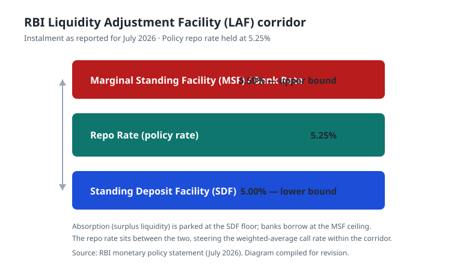

# 3. ECONOMY

[↑ Back to Monthly Index](../CURRENT_AFFAIRS_JULY_2026.md#toc)

## 3.1. RBI MONETARY POLICY AND THE GROWTH-INFLATION BALANCE

**Why in News?**
The Reserve Bank of India has kept the benchmark policy repo rate unchanged at **5.25%** in the current cycle. A Reuters poll of economists (27 July 2026) indicated that the Monetary Policy Committee (MPC) is widely expected to hold rates again at its **3–5 August 2026** meeting, even as Governor **Sanjay Malhotra** described talk of rate hikes as "premature." The RBI has projected **GDP growth of 6.9% for FY2026-27**.

**About the current monetary policy stance**
- **Repo Rate:** 5.25% (unchanged).
- **Standing Deposit Facility (SDF):** 5.00%.
- **Marginal Standing Facility (MSF):** 5.50%.
- **Bank Rate:** 5.50%.
- The MPC retained its stance, balancing the need to support growth against inflation risks from food and global uncertainty.

**Key signals**
- The Governor's remark that discussing rate hikes is "premature" suggests the RBI is in a prolonged pause rather than a tightening cycle.
- FY27 growth projection of 6.9% reflects confidence in domestic demand even amid global headwinds.

**Challenges**
- Sticky food inflation (CFPI above 5%) complicates the inflation-targeting framework.
- Global trade uncertainty and conflict-driven commodity shocks can transmit into domestic prices.

**Way Forward**
- Continued data-dependent calibration, with emphasis on anchoring inflation expectations while nurturing the growth recovery.

*Figure: RBI Liquidity Adjustment Facility corridor as of July 2026 (self-authored diagram).*

*Source: RBI, Reuters, 27 Jul 2026*

## 3.2. SEMICON 2.0 — CABINET APPROVES EXPANDED SEMICONDUCTOR MISSION

**Why in News?**
The Union Cabinet approved **"Semicon 2.0"** on **15 July 2026**, a substantially expanded version of the earlier semiconductor programme, with an outlay of roughly **₹1,27,500 crore** and a much broader scope across six pillars.

**About Semicon 2.0**
- **Six pillars:** covering logic and memory fabs, compound semiconductors, display fabs, packaging/ATMP, design, and R&D/skilling.
- **Capex support:** up to **40%** for logic and memory fabs; up to **35%** for compound semiconductor and display units.
- The mission targets mobilising roughly **₹4 lakh crore** of investment across the ecosystem.
- It moves beyond the first phase (which focused primarily on setting up fabs and ATMP/OSAT units) toward a full-stack capability.

**Significance**
- Strengthens India's ambition to become a reliable node in the global semiconductor value chain amid supply-chain diversification ("China+1").
- Complements related missions in electronics manufacturing and the India Semiconductor Mission ecosystem.

**Challenges**
- Access to ultrapure water, specialised gases and advanced lithography remains difficult.
- Shortage of trained semiconductor engineers and technicians.
- Long gestation periods and capital intensity of leading-edge fabs.

**Way Forward**
- Tie-ups with global foundries, focused skilling, and a robust domestic design ecosystem.

*Source: PIB, Cabinet, 15 Jul 2026*

## 3.3. INDIA–UK CETA AND SOCIAL SECURITY AGREEMENT ENTER INTO FORCE

**Why in News?**
The **India–UK Comprehensive Economic and Trade Agreement (CETA)**, along with the **Double Contribution Convention (DCC)** on social security, entered into force on **15 July 2026**, marking a major milestone in India's trade diplomacy.

**About the agreement**
- Provides **zero-duty access for about 99% of India's exports** to the United Kingdom.
- The **DCC** exempts Indian professionals temporarily working in the UK (and vice versa) from double social-security contributions, boosting services and mobility.
- On the very first day, **over 50 consignments** worth more than **US$140 million** were flagged off, signalling immediate market access gains.

**Significance**
- Enhances India's export competitiveness in textiles, leather, gems & jewellery, engineering goods and agriculture.
- Strengthens the services and professional-mobility corridor with a key developed market.
- Signals India's strategy of concluding balanced, modern trade agreements.

**Challenges**
- Realising benefits requires compliance with UK standards and effective utilisation of preferential access.
- Non-tariff barriers and rules-of-origin compliance.

**Way Forward**
- Export support, quality upgradation and active trade-facilitation outreach to MSMEs.

*Source: PIB, 15 Jul 2026*

## 3.4. IMF WORLD ECONOMIC OUTLOOK UPDATE — JULY 2026

**Why in News?**
The IMF released its **World Economic Outlook (WEO) Update** on **8 July 2026**, themed on the global economy in the "crosscurrents of war and technology," containing revised global and country growth projections.

**Key takeaways**
- **Global growth** projected at **3.0% in 2026** and **3.4% in 2027**.
- **India's growth for 2026** revised marginally downward to **6.4%**, but India remains the **fastest-growing major economy**.
- The report highlights the dual forces of geopolitical conflict and rapid technological adoption (especially AI) reshaping growth.

**Significance**
- India's relative outperformance supports its role as a global growth engine.
- Reinforces the importance of domestic demand, investment and supply-chain resilience.

**Challenges**
- Slowing global trade, protectionism and geopolitical fragmentation.
- Technology-driven disruptions in labour markets.

**Way Forward**
- Sustained public capex, structural reforms and investment in human capital and technology.

*Source: IMF WEO Update, 8 Jul 2026*

## 3.5. NEWS IN SHORTS

### 3.5.1. GST COLLECTIONS CROSS ₹2.11 LAKH CRORE IN JULY 2026
- Gross GST revenue for July 2026 stood at **₹2,11,205 crore**, registering **15.4% year-on-year growth**.
- The mop-up comprised **CGST of ₹39,835 crore** and **SGST of ₹47,881 crore**, among other heads.
- Robust collections reflect strengthening consumption, improved compliance and formalisation.
- Sustained growth in GST revenue is a key fiscal cushion for the Centre and States.
- *(Source: GST Portal / Ministry of Finance, Jul–Aug 2026)*

### 3.5.2. UPI SETS NEW RECORD IN JULY 2026
- UPI processed a record **23.66 billion transactions** worth **₹29.88 trillion** in July 2026.
- Volumes rose about **4.1% month-on-month** and **22% year-on-year**.
- **IMPS** clocked 364 million transactions worth ₹7.12 trillion.
- **AePS** recorded 100 million transactions worth ₹27,539 crore.
- Reflects deepening digital-payment penetration across the country.
- *(Source: NPCI / Business Standard, Aug 2026)*

### 3.5.3. FOREX RESERVES
- India's foreign-exchange reserves stood at **US$676,237 million** for the week ended **17 July 2026**.
- Adequate reserves provide an import cover and shield against external shocks.
- *(Source: RBI Weekly Statistical Supplement, 24 Jul 2026)*

### 3.5.4. RETAIL INFLATION (CPI) FOR JULY 2026
- Headline **CPI inflation** (new base 2024=100) stood at **4.45%** in July 2026.
- Rural inflation was **4.84%**; urban inflation **3.96%**.
- **Consumer Food Price Index (CFPI)** inflation was **5.52%**; housing inflation **2.22%**.
- Final June 2026 CPI was 4.38% with CFPI at 5.32%.
- *(Source: MoSPI, Aug 2026)*

### 3.5.5. EXTERNAL TRADE DATA (JUNE 2026)
- Total exports in June 2026 were **US$73.45 billion (+9.48%)**; total imports **US$88.76 billion**.
- Merchandise exports stood at US$40.41 billion; merchandise imports US$70.84 billion.
- For Apr–Jun 2026-27 (Q1), exports were **US$232.73 billion (+11.37%)** and imports **US$270.15 billion (+17.55%)**.
- The monthly trade deficit was **US$15.32 billion**.
- *(Source: Ministry of Commerce & Industry, Jul 2026)*

### 3.5.6. RBI FINANCIAL STABILITY REPORT
- The RBI's **Financial Stability Report (30 June 2026)** concluded that banks and NBFCs remain sound, with low NPAs and strong capital buffers.
- Highlights macro-financial resilience amid global uncertainty.
- *(Source: RBI, Jun 2026)*

### 3.5.7. INDIA–US TRADE ENGAGEMENT
- Reuters (13 July 2026) reported **no consensus** in India–US trade negotiations.
- The US placed India in a **10% Section 301 bracket**.
- About **45% of India's exports to the US** remain outside additional duty.
- Trade uncertainty persists over tariff structure.
- *(Source: Reuters, Economic Times, Jul 2026)*

### 3.5.8. SMALL MODULAR REACTORS (SMRs) — INDIGENOUS PUSH
- **BARC** is developing a **220 MW Bharat Small Modular Reactor**, a **55 MW reactor** and a **High-Temperature Gas-Cooled Reactor (HTGR)** for hydrogen.
- The Atomic Energy Commission approved a site at **Tarapur (Maharashtra)**.
- Target: **5 indigenous SMRs by 2033**, under the **Nuclear Energy Mission** to reach **100 GWe by 2047**.
- SMRs offer modular, lower-cost, site-flexible clean baseload power.
- *(Source: Reuters / PIB, 22 Jul 2026)*

### 3.5.9. UNION BUDGET 2026-27 — CAPEX AND FISCAL CONSOLIDATION
- Public capital expenditure of **₹12.2 lakh crore** budgeted.
- Real GDP for FY2025-26 estimated at **7.4%** (nominal 8%).
- Debt-to-GDP glide path targets **50±1% by 2030-31**.
- Focus areas include semiconductors, medical-tourism hubs, and a **High Level Committee on Banking for Viksit Bharat**.
- *(Source: Union Budget 2026-27 / PIB, Feb 2026)*

### 3.5.10. 16TH FINANCE COMMISSION
- Vertical devolution to States retained at **41%**.
- The Commission submitted its report on **17 November 2025**.
- **₹1.4 lakh crore** in Finance Commission Grants provided for FY2026-27.
- *(Source: PIB)*

[↑ Back to Monthly Index](../CURRENT_AFFAIRS_JULY_2026.md#toc)
