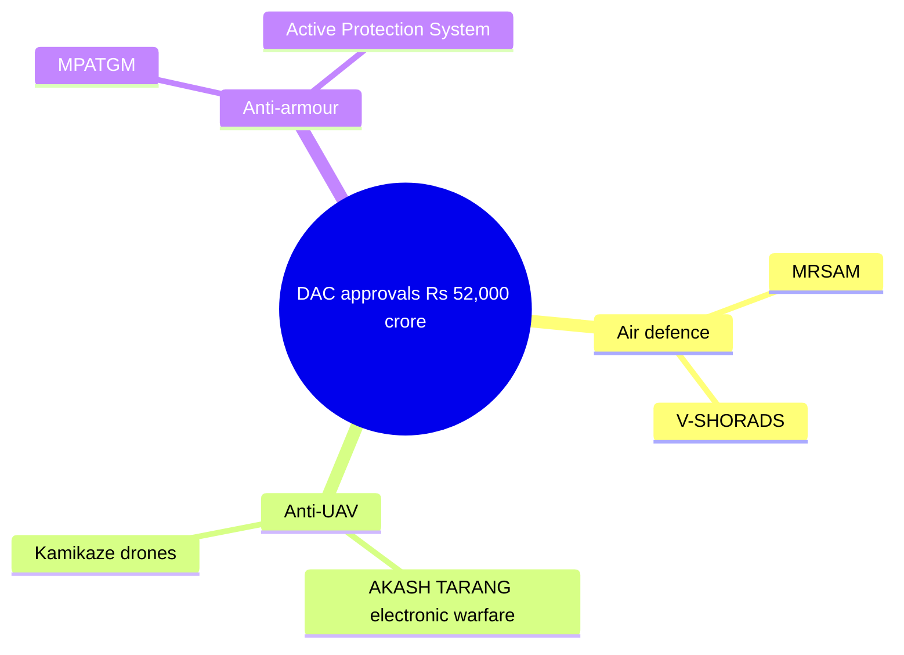

# 4. SECURITY

[↑ Back to Monthly Index](../CURRENT_AFFAIRS_JULY_2026.md#toc)

## 4.1. DRDO FLIGHT-TESTS 'KUSHA' LONG-RANGE SAM

**Why in News?**
The Defence Research and Development Organisation (**DRDO**) conducted the **maiden flight-test of the 'Kusha' Long-Range Surface-to-Air Missile (LR-SAM)** system on **23 July 2026** from Dr. APJ Abdul Kalam Island, off the Odisha coast. The test successfully **intercepted an electronic high-speed, high-altitude target**.

**About the Kusha LR-SAM**
- An indigenous **long-range air-defence system** designed to neutralise high-value aerial threats such as fighter aircraft, cruise missiles and drones at extended ranges and altitudes.
- Represents a significant step in India's push for self-reliance in advanced air-defence technology under **Project Kusha**.
- Complements existing indigenous systems and strengthens layered air defence.

**Significance**
- Enhances the armed forces' ability to protect strategic assets and territory against modern aerial threats.
- Reduces dependence on imported long-range air-defence systems.

**Way Forward**
- Subsequent developmental trials, user trials and integration with the services' air-defence networks.

*Source: DRDO / MoD, 23 Jul 2026*

## 4.2. INS MAHENDRAGIRI COMMISSIONED — PROJECT 17A FRIGATE

**Why in News?**
**INS Mahendragiri**, the **sixth and final stealth frigate of the Project 17A (Nilgiri-class)** programme, was commissioned at **Visakhapatnam on 11 July 2026**. The ship features **about 75% indigenous content**.

**About Project 17A**
- A class of stealth-guided-missile frigates built under the **P-17A programme** for the Indian Navy.
- Designed for multi-mission roles including anti-air, anti-surface, anti-submarine warfare and surveillance.
- High indigenous content reflects the growth of India's shipbuilding and defence-industrial base.

**Significance**
- Completes a major indigenous warship-building programme.
- Boosts the Navy's blue-water capabilities and operational reach.

**Way Forward**
- Focus on the next-generation warship programmes and deeper indigenisation, including weapons and sensors.

*Source: Indian Navy / MoD, 11 Jul 2026*

## 4.3. DEFENCE ACQUISITION COUNCIL APPROVALS — ~₹52,000 CRORE

**Why in News?**
The **Defence Acquisition Council (DAC)**, in a meeting on **3 July 2026**, granted **Acceptance of Necessity (AoN)** for procurements worth approximately **₹52,000 crore**, with a strong focus on indigenous capability and anti-drone systems.

**Key approvals**
- **AKASH TARANG** — an anti-UAV electronic-warfare system for the Army.
- **Man-Portable Anti-Tank Guided Missile (MPATGM)**.
- **Medium-Range Surface-to-Air Missile (MRSAM)** systems.
- **Very Short-Range Air Defence (V-SHORADS)** systems.
- An **Active Protection System (APS)** for armoured vehicles.
- **Jet-powered kamikaze drones**.

**Significance**
- Addresses emerging threats, especially from unmanned platforms.
- Reinforces the government's push for indigenous defence manufacturing.

**Way Forward**
- Efficient contracting, timely delivery and indigenous content verification.

*Source: MoD / DAC, 3 Jul 2026*

## 4.4. NEWS IN SHORTS

### 4.4.1. SIPRI — INDIA IS WORLD'S 5TH LARGEST MILITARY SPENDER (2025)
- Stockholm International Peace Research Institute (**SIPRI**) reported India as the **5th largest military spender in 2025**.
- India's defence spending rose **8.9% to US$92.1 billion**.
- The top-5 spenders — **US, China, Russia, Germany and India** — accounted for **58% of global military expenditure**.
- The rise was partly driven by the **post-May 2025 India–Pakistan conflict**.
- *(Source: SIPRI, Apr 2026)*

### 4.4.2. DEFENCE EXPORTS AT RECORD HIGH
- India's defence exports reached a record **₹38,424 crore in FY2025-26**, up **62.66% year-on-year**.
- **DPSUs contributed 54.84%** and the **private sector 45.16%**.
- Exports reached **80+ countries**, with **145 exporters**.
- Reflects maturing of the indigenous defence-industrial ecosystem.
- *(Source: PIB, 2026)*

### 4.4.3. BRAHMOS EXPORTS AND DEFENCE DIPLOMACY
- India is set to supply **Indonesia two BrahMos batteries** worth about **US$200 million**, along with **Astra air-to-air missiles** and technology transfer (July 2026).
- India is also exporting BrahMos to the **Philippines and Vietnam**, with talks on with about **six more countries**.
- Underscores India's emergence as a credible defence exporter.
- *(Source: MoD / Media reports, Jul 2026)*

### 4.4.4. AGNIPATH — SERVICES SEEK HIGHER RETENTION
- The armed services have pitched for **higher retention of Agniveers** in the regular cadre.
- The **Navy sought about 75%** retention; the **Army and IAF about 50%**, against the current **25%**.
- The proposal relates to absorption of trained Agniveer personnel.
- *(Source: Indian Express, 6 Jul 2026)*

### 4.4.5. RIMPAC 2026 — INDIA PARTICIPATES
- The **Rim of the Pacific (RIMPAC) 2026** exercise was held from **24 June to 31 July 2026** in Hawaii.
- India participated with a **P-8I** maritime patrol aircraft.
- The **30th edition** involved **30 nations**, 30 ships, 5 submarines, 190+ aircraft and 30,000+ personnel.
- The world's largest international maritime exercise enhances interoperability.
- *(Source: Indian Navy / US Navy, Jul 2026)*

### 4.4.6. MANIPUR — 46 KCP CADRES SURRENDER
- **46 cadres of the Kangleipak Communist Party (KCP-PWG)** surrendered at **Mantripukhri Garrison, Manipur, on 21 July 2026**.
- They laid down **28 weapons**.
- Reflects continued progress in restoring normalcy and reintegration in the State.
- *(Source: Indian Army / PIB, 21 Jul 2026)*

### 4.4.7. LEFT WING EXTREMISM — SHARP DECLINE
- The **Ministry of Home Affairs** informed the **Rajya Sabha (July 2026)** that LWE-affected districts had fallen to **"zero"** in March 2026, down from **126 before April 2018**.
- The **last active CPI(Maoist) politburo member, Misir Besra**, was neutralised.
- **37 districts** remain classified as **"legacy and thrust"** for continued focus.
- Reflects the success of a multi-pronged security-plus-development approach.
- *(Source: MHA / Rajya Sabha, Jul 2026)*

### 4.4.8. SPACE — SKYROOT'S VIKRAM-1 AND GSLV-F17/EOS-05
- **Skyroot Aerospace** launched **Vikram-1**, India's first private rocket (a seven-storey vehicle), from **Sriharikota on 18 July 2026**, reaching low Earth orbit (~450 km).
- **GSLV-F17 / EOS-05** launch was scheduled for **4 September 2026**.
- Marks the growing role of the private space sector alongside ISRO.
- *(Source: ISRO / Skyroot, Jul 2026)*

[↑ Back to Monthly Index](../CURRENT_AFFAIRS_JULY_2026.md#toc)
