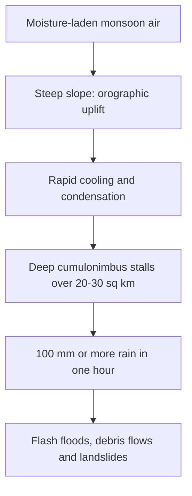

# 5. ENVIRONMENT

[↑ Back to Monthly Index](../CURRENT_AFFAIRS_JULY_2026.md#toc)

## 5.1. CLOUDBURSTS IN INDIA: RISING HIMALAYAN HYDRO-HAZARDS

**Why in News?**
Repeated episodes of extreme monsoon downpours during July 2026 across Uttarakhand, Himachal Pradesh and Jammu & Kashmir triggered flash floods and landslides, once again turning the spotlight on cloudbursts as a distinct and under-studied hydro-meteorological hazard in the Himalayan region.

**About Cloudbursts**

- The India Meteorological Department (IMD) defines a **cloudburst** as an extreme, highly localised event in which an area of about **20–30 sq. km receives 100 mm (10 cm) or more of rainfall within one hour**.
- The volume of water released far exceeds the ground's capacity to absorb it, producing sudden and destructive flash floods, debris flows and landslides.
- Scientists also recognise a **"mini-cloudburst"** category (about 5 cm of rain in an hour over the same area), which can be equally devastating depending on local mountain topography.

**How a Cloudburst Occurs**

| Process | Description |
|---|---|
| Moisture incursion | Intense monsoon currents carry large quantities of moisture-laden air against steep slopes. |
| Orographic uplift | Mountains force this air to rise rapidly, causing sudden condensation. |
| Convective buildup | A single, deep cumulonimbus cloud stalls over a small area, releasing its entire water content in a short burst. |
| Cascade effect | Saturated slopes, deforested catchments and unplanned construction convert rainfall into violent surface runoff. |

**Why the Himalayas are Vulnerable**

- **Steep, fragile terrain** with thin soils and high gradients accelerates runoff and debris movement.
- **Changing climate** is increasing the frequency of short-duration, high-intensity rainfall events.
- **Land-use change** — deforestation, road-cutting, hydel projects and haphazard construction — reduces infiltration and slope stability.
- **Glacial retreat and permafrost thaw** add secondary hazards such as glacial lake outburst floods (GLOFs).

**Impacts**

- Loss of life and livelihoods; destruction of roads, bridges and hydropower infrastructure.
- Displacement of hill communities; disruption of tourism and pilgrimage routes.
- Downstream flooding and sedimentation in the Gangetic plains.

**Response and Institutional Framework**

- IMD issues **nowcasts** and colour-coded warnings; Doppler weather radars cover parts of the Himalayan belt.
- **NDMA** guidelines on landslides, flash floods and GLOFs; State Disaster Management Authorities coordinate relief.
- Early-warning systems and community-based preparedness remain uneven across the region.

**Way Forward**

- Densify the **rain-gauge and radar network** and invest in high-resolution regional climate modelling.
- Enforce **land-use and construction regulations** in ecologically sensitive zones.
- Integrate cloudburst risk into **hydel, road and urban planning**; strengthen catchment treatment and afforestation.
- Build **community resilience** through mock drills, local early-warning dissemination and hazard mapping.

**Conclusion**
Cloudbursts are a potent illustration of how climate change interacts with fragile Himalayan geography. Disaster risk reduction must move from relief-centric responses to prevention, land-use discipline and robust early warning.

*Source: The Hindu, 31 July 2026; IMD; NDMA*

---

## 5.2. THE DRAFT CAFE-III NORMS AND INDIA'S ROAD TO CLEANER MOBILITY

**Why in News?**
The Ministry of Power, along with the Bureau of Energy Efficiency (BEE), released the **Draft Corporate Average Fuel Economy-III (CAFE-III) norms** for public and industry consultation, marking the next stage of India's regulatory push towards cleaner transport.

**About the CAFE Framework**

- CAFE norms mandate that an automaker meet a **sales-weighted average** fuel-efficiency and CO₂-emission target across its **entire annual fleet**, rather than for individual models.
- Administered under the **Energy Conservation Act**, they aim to cut greenhouse gas emissions, improve urban air quality and reduce crude oil imports.

| Phase | Timeline | Snapshot |
|---|---|---|
| CAFE-I | FY2017–18 | Baseline for fleet-efficiency tracking |
| CAFE-II | FY2022–23 | Tighter targets using an average vehicle-weight constant |
| CAFE-III | Draft July 2026; effective 1 April 2027 to FY2031–32 | Most ambitious standards yet |

**Key Features of CAFE-III**

- **Progressively tighter carbon targets:** fleet-average emissions decline from about **94.76 gCO₂/km (FY2027–28)** to a strict **~78.90 gCO₂/km by FY2031–32**.
- **Shift to the WLTP cycle:** migration from the laboratory-based Modified Indian Driving Cycle (MIDC) to the globally harmonised **Worldwide Harmonised Light Vehicles Test Procedure (WLTP)**, reflecting real-world driving.
- **Flexible compliance blocks:** compliance is assessed over a three-year block (FY28–30) and a two-year block (FY30–32), giving automakers room to phase in EV launches.
- **Carbon Neutrality Factors (CNFs):** first-ever mechanism to credit genuinely low-carbon technologies.
- **Credit buyout pricing:** firms facing a shortfall may purchase compliance credits from BEE starting at ₹2,500 per gCO₂/km (FY2028), rising to ₹4,500 by FY2032 — well below the Energy Conservation Act penalty threshold.

**India's Mobility Transition: The Wider Picture**

- The **IEA Global EV Outlook 2026** places EV share in India's new passenger-car sales at roughly **4% (2025)**, against nearly 55% in China, 27% in the EU and 10% in the US.
- Major domestic OEMs have **voluntarily pledged** an average 20–30% EV share by 2030.
- Support architecture includes the **FAME scheme**, **PM E-DRIVE**, and **Production-Linked Incentive (PLI)** schemes for advanced automotive technology.

**Why Clean Mobility Matters for India**

- **Energy security:** India imports the bulk of its crude, exposing the economy to West Asian supply shocks.
- **Air quality:** transport is a leading source of PM₂.₅ in major cities.
- **Industrial competitiveness:** strong domestic EV/hybrid supply chains prevent technological lock-out.
- **Climate commitments:** supports the Panchamrit targets and the net-zero-by-2070 goal.

**Challenges**
- Weak charging infrastructure and grid readiness; high upfront EV costs.
- Compliance burden and technology costs for smaller OEMs.
- Risk of credit-buyout becoming a cheaper substitute for genuine emission cuts.

**Way Forward**
- Link CAFE credit markets with a robust **carbon-compliance monitoring** regime.
- Accelerate charging networks and battery recycling under a circular-economy framework.
- Prioritise public transport electrification and freight efficiency alongside passenger cars.

**Conclusion**
CAFE-III signals a decisive shift from tokenism to measurable fleet decarbonisation. Its success will hinge on complementary infrastructure, credible enforcement and affordable clean technology.

*Source: Business Standard, 18 July 2026; The Hindu, 28 July 2026; BEE; IEA Global EV Outlook 2026*

---

## 5.3. NEWS IN SHORTS

### 5.3.1. THE NATIONAL BIODIVERSITY AUTHORITY AND THE INVASIVE ALIEN SPECIES CHALLENGE

- Acting on a **suo motu proceeding by the National Green Tribunal (NGT)**, the **National Biodiversity Authority (NBA)** constituted a multi-disciplinary **Expert Committee on Invasive Alien Species**.
- The NBA is an **autonomous statutory body** under the **MoEFCC**, established on **1 October 2003** to implement the **Biological Diversity Act, 2002**.
- It performs **regulatory, advisory and facilitative** functions, ensuring **Access and Benefit Sharing (ABS)** from India's biological resources and traditional knowledge.
- It advises on notification of **Biodiversity Heritage Sites (Section 37)** and coordinates with **28 State Biodiversity Boards** and nearly **2.76 lakh Biodiversity Management Committees (BMCs)** maintaining **People's Biodiversity Registers (PBRs)**.
- Its core purpose is to **prevent biopiracy** and secure fair benefits for local communities.

*Source: News on Air, 27 July 2026*

### 5.3.2. INDIA'S RICE FIELDS AS GLOBAL METHANE HOTSPOTS

- A study in **Nature Food** found that India's **irrigated paddy fields** are among the world's largest **methane hotspots**, emitting about **3.9 million tonnes of methane annually** — more than Germany's total yearly methane emissions.
- Global GHG emissions from paddy fields have nearly **doubled since the 1960s**, reaching about **1.1 billion tonnes CO₂-equivalent annually (2011–2020)**.
- Over **one-third of global paddy soils** have become carbon sources, losing soil organic carbon.
- Rice-related emissions are projected to rise by about **26% during 2031–2050**.
- Mitigation options include **Alternate Wetting and Drying (AWD), Direct Seeded Rice (DSR), System of Rice Intensification (SRI)** and crop diversification.

*Source: Nature Food, July 2026 (reported 24 July 2026)*

### 5.3.3. INDIAN GREY HORNBILL RETURNS TO GIR

- More than **60 years** after disappearing from Gujarat's **Gir forests**, the **Indian Grey Hornbill** has re-established a presence following a reintroduction programme by the Gujarat Forest Department.
- Scientific name: **_Ocyceros birostris_**; family **Bucerotidae**; **IUCN status: Least Concern**.
- It is endemic to the Indian subcontinent and thrives in open deciduous forests, thorn scrub, riparian woodland and even urban parks with mature hollow trees.
- It is a **frugivore and key seed disperser**, aiding forest regeneration; the female seals herself in a tree cavity for nesting.

*Source: The Hindu, 16 July 2026*

### 5.3.4. LESTES PALOTI: A NEW SPREADWING DAMSELFLY

- A team of odonatologists described a new spreadwing damselfly, **_Lestes paloti_**, from the **Western Ghats of Kerala**.
- Belongs to family **Lestidae**, order **Odonata**; named in honour of Dr. Muhamed Jafer Palot of the **Zoological Survey of India (ZSI)**.
- Recorded across six Kerala districts — Kannur, Kozhikode, Wayanad, Malappuram, Palakkad and Ernakulam.
- Unlike many relatives, it inhabits **scrub vegetation around homesteads and laterite hillocks** rather than open water bodies — underlining the conservation value of neglected habitats.

*Source: The Hindu, 20 July 2026*

### 5.3.5. ECOLOGICAL REVIVAL OF MANASBAL LAKE

- Large-scale **de-weeding and channel dredging** over **70,000 sq. ft** has triggered clear signs of ecological recovery in **Manasbal Lake**, Jammu & Kashmir.
- Often called the "supreme gem of Kashmir lakes," it is recognised as **India's deepest natural freshwater lake**, reaching about **13 metres (43 ft)**.
- Located in **Ganderbal district**, about 30 km north of Srinagar, within the Jhelum basin; formed during the third major Himalayan glaciation.
- Flanked by the **Baladar mountains** (east), the **Karewa plateau** (north) and the limestone-rich **Ahtung hills** (south).

*Source: The Hindu, 20 July 2026*

### 5.3.6. INDIA COMMISSIONS FIRST GEOTHERMAL WELLS AT PUGA VALLEY

- Ladakh's Lieutenant Governor commissioned India's first and deepest twin **geothermal wells** at **Puga Valley** in eastern Ladakh, drilled to **1,000 metres**.
- Executed by the **ONGC Energy Centre**, they will power India's first **1 MWe demonstration-scale geothermal plant**.
- Located above **14,000 ft**, the field benefits from mantle heat brought close to the crust by the **Indus Suture Zone**.
- A temperature of **135°C was recorded at just 400 m**, with deeper sections expected to exceed **200–240°C**.
- Geothermal energy offers **24×7 baseload power**, replacing diesel in remote Ladakh and supporting net-zero goals.

*Source: Times of India, 18 July 2026*

### 5.3.7. THE PARIVARTAN SCHEME

- The **Delhi Cabinet** approved implementation of the Centre's **Parivartan** scheme to replace old commercial vehicles with **BS-VI-compliant and electric** alternatives.
- Full form: **Programme for Accelerated Renewal and Incentivisation of Vehicle Assets for Reducing Transport Air Pollution and Network Emission**.
- Offers **motor vehicle tax exemptions, registration fee waivers, interest subsidies, OEM discounts and fuel vouchers**.
- Covers **Light, Medium and Heavy Goods Vehicles and buses**; mandates electric LGVs and BS-VI CNG or electric buses in Delhi.
- Complements the **Vehicle Scrappage Policy** and the **Delhi EV Policy 2026**.

*Source: PIB / Insights, 22 July 2026*

### 5.3.8. NAMO GREEN RAIL AND PEM FUEL CELL TECHNOLOGY

- The Prime Minister flagged off India's first **hydrogen-powered train, the NaMo Green Rail**, on the **89-km Jind–Sonipat section** in Haryana.
- It is powered by a **Proton Exchange Membrane (PEM) fuel cell** — a compact electrochemical generator converting hydrogen's chemical energy into clean electricity.
- At the **anode**, a catalyst splits hydrogen into protons and electrons; a polymer membrane passes only protons, forcing electrons through an external circuit to generate power.
- Specifications were drafted by **RDSO** and the system integrated by **Medha Servo Drives**.

*Source: The Hindu, 18 July 2026*

### 5.3.9. NATIONAL INVESTMENT POLICY FOR UREA-2026 (NIPU-2026)

- The **CCEA** approved the **National Investment Policy for Urea-2026 for Atmanirbhar Bharat (NIPU-2026)**, successor to the New Investment Policy-2012.
- Aims to add **10 million tonnes** of fresh indigenous urea capacity through **8–9 new natural gas-based plants**.
- Separates **fixed and variable costs** for subsidy calculation to enhance transparency.
- Assures an **RoE band of 12% (floor) to 16% (ceiling)** for developers.
- Reinforces fertiliser self-reliance with implications for **soil health and balanced nutrient use**.

*Source: Indian Express, 16 July 2026*

### 5.3.10. THE GANDAK RIVER: A TRANSBOUNDARY HIMALAYAN RIVER

- The **Gandak (Narayani/Kali Gandaki)** is one of the largest left-bank tributaries of the Ganga.
- It originates near the **Nhubine Himal Glacier** in Nepal's Mustang region at about **6,268 m**.
- Flows as the **Kali Gandaki** through Nepal's gorges, becoming the **Narayani** near Devghat before entering India at **Triveni**.
- Forms the UP–Bihar boundary briefly and joins the Ganga at **Hajipur**.
- Symbolises India–Nepal **transboundary water cooperation** and flood management challenges.

*Source: Insights IAS, 16 July 2026*

### 5.3.11. UNESCO'S LIST OF WORLD HERITAGE IN DANGER

- Established under the **1972 World Heritage Convention**, the **List of World Heritage in Danger** flags properties threatened by conflict, disasters, urbanisation, poaching or pollution.
- At the **48th World Heritage Committee session in Busan, South Korea**, six vulnerable sites were added.
- **Boma-Badingilo Migratory Landscape (South Sudan)** was inscribed on an emergency basis.
- The mechanism enables UNESCO to channel **emergency technical assistance** and press member states for corrective action.

*Source: UNESCO, 27 July 2026*

*Source note: This section compiles verified July 2026 environment and climate developments drawn from PIB, MoEFCC, The Hindu, Business Standard, Indian Express, Nature Food, IMD and UNESCO.*

[↑ Back to Monthly Index](../CURRENT_AFFAIRS_JULY_2026.md#toc)
